# PlanetaFactory (nome provisório)

Jogo de automação/fábrica para PC e celular. **Você é uma inteligência artificial com defeito** — uma unidade
semeadora que chega a um planeta com uma única diretriz: **proliferar**. Ela não destrói o ambiente de propósito:
constrói, coleta, se modifica, se melhora e se espalha — e o planeta muda (por bem ou por mal) como consequência.
O planeta é vivo e o "sistema imunológico" dele reage. Mundo procedural infinito e contínuo; a grade 1×1 é só o
sistema de construção. O jogo começa com o núcleo caindo do espaço.

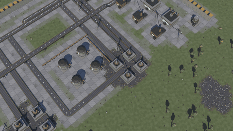

**Baixar para Android:** [última versão](https://github.com/Sapyst/PlanetaFactory/releases/latest) ·
**Vídeo do voo completo (18 s, MP4):** na página da [versão 0.3.3](https://github.com/Sapyst/PlanetaFactory/releases/tag/v0.3.3)

## Galeria

| | |
|---|---|
| 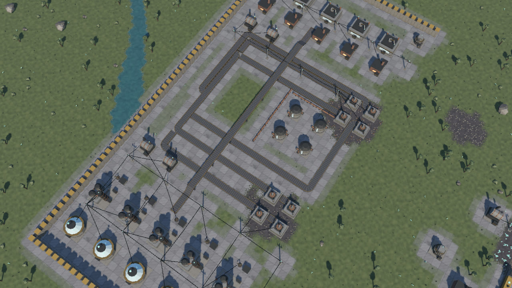 | 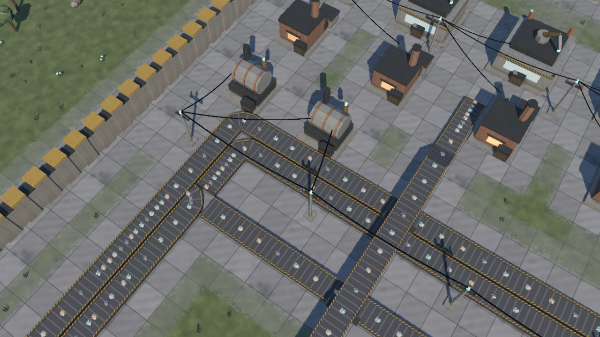 |
| Fábrica murada: brocas nas jazidas, barramento de esteiras, elevada cruzando, blocos de máquinas | De perto: itens correndo nas esteiras, geradores ligados por fios automáticos |
| 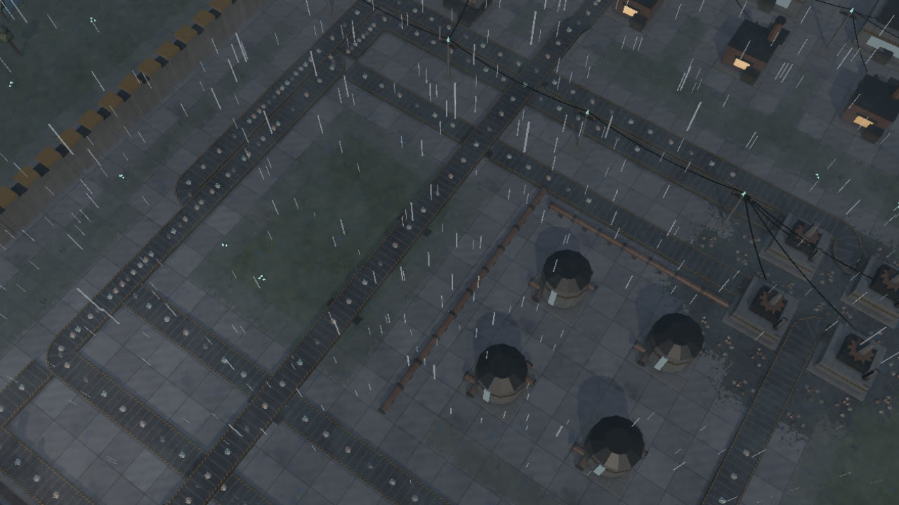 | 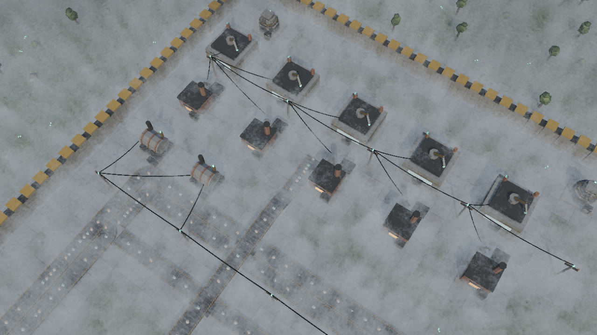 |
| Chuva: chão molhado e poças; a chuva ajuda a limpar a poluição | Neblina de chão com corpo: as máquinas saem de dentro dela |
| 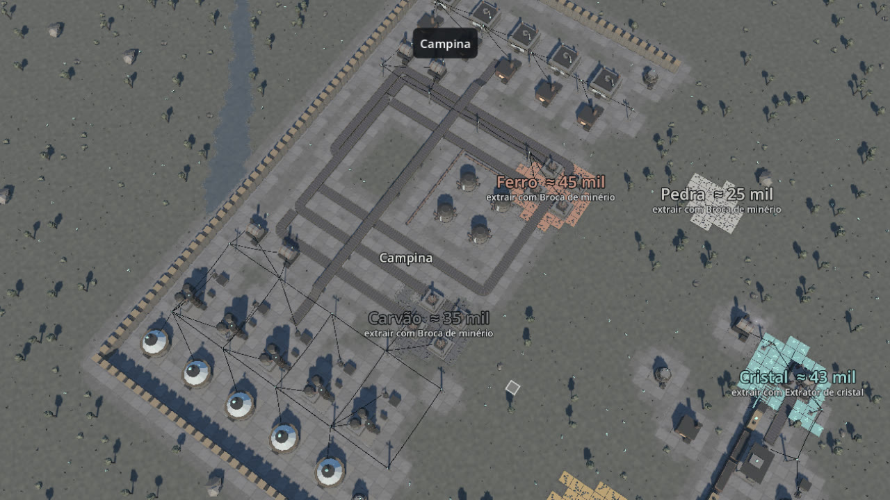 | 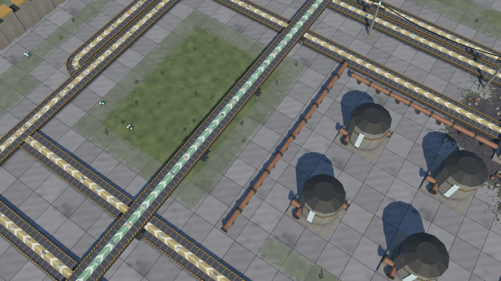 |
| Visão de recursos (tecla V): cada jazida com nome, quantidade e máquina | Modo construção: setas mostram o sentido de cada esteira (cor por nível) |
| 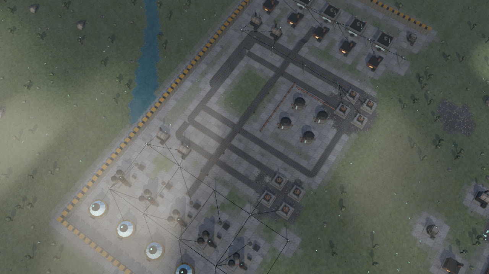 | 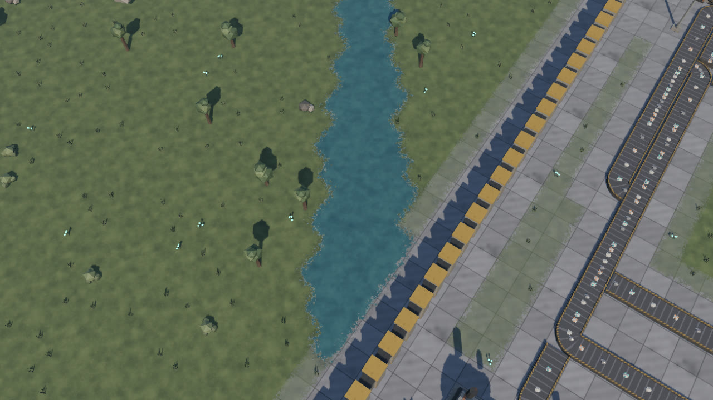 |
| Nuvens altas: luz parcial e passagens diretas de sol | O mundo é natural (margens redondas); só as construções seguem a grade 1×1 |
| 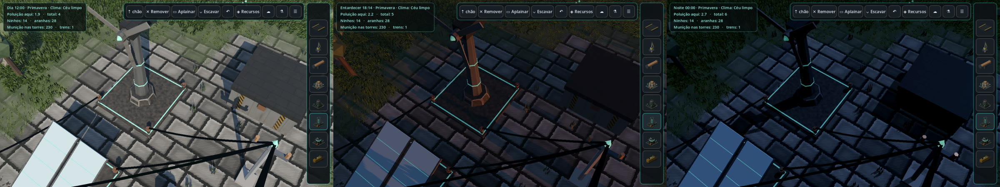 | 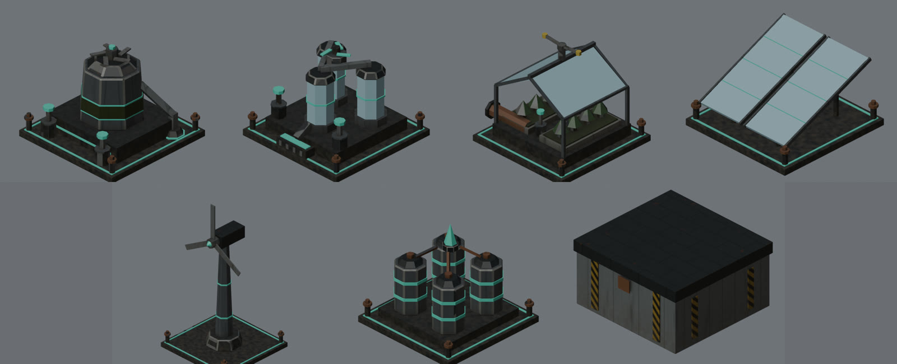 |
| Dia, entardecer e noite: à noite o painel solar para e os cristais das máquinas se destacam | Coletor de lixo, filtro de água, viveiro, painel solar, turbina eólica, acumulador e baú grande |
| 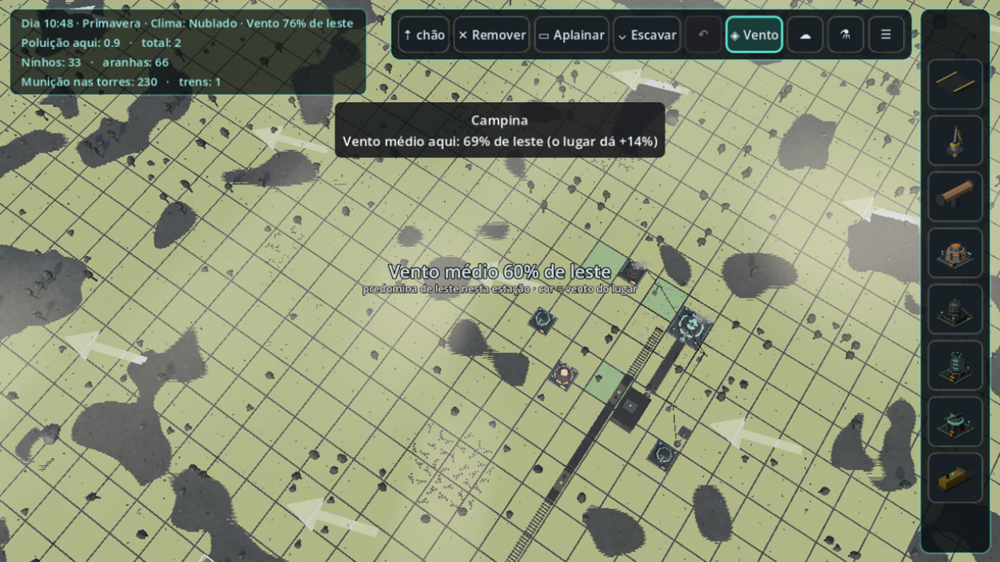 | |
| Visão de recursos, camada Vento: vento médio de cada lugar e a direção predominante | |

## Pastas
- `jogo/` — projeto Godot 4.7 (código, dados, testes). Ver `jogo/README.md`.
- `arte/` — modelos 3D, texturas e o verificador. Ver `arte/FICHA_DE_ESTILO.md` e `arte/CATALOGO.md`.
- `docs/RECURSOS.md` — **guia dos recursos**: cada jazida (cor, item, máquina, em que bioma aparece), biomas, águas e o que
  cada elemento natural rende. Gerado dos dados por `jogo/ferramentas/gerar_doc_recursos.py`.
- `docs/PLANO_CLIMA.md` — plano das próximas versões: vento, árvores, tempestades com raios, água e drones.
- `docs/MUNDO.md` — geração procedural e distribuição por bioma. `docs/fotos/` — capturas reais do jogo.

## Fluxo de trabalho (sem precisar abrir nada)
1. `arte/blender_scripts/gerar_tudo.sh` — regenera os 95 modelos + texturas, checa cada um, gera pranchas e catálogo, copia para o jogo.
2. `jogo/ferramentas/testar.sh` — importa e roda todos os testes do jogo sem janela.
3. `godot --path jogo --write-movie /tmp/q.png --fixed-fps 30 --quit-after 70 -- camera X Z DIST` — foto real.
4. `python3 jogo/ferramentas/gerar_sons.py` — sintetiza os sons; `python3 jogo/ferramentas/gerar_nuvens.py` — mapa das nuvens.
5. `godot --headless --path jogo --export-debug "Android" jogo/export/PlanetaFactory-0.10.0.apk` — APK.
6. `... -- camera -3 2 11 roteiro construir` (ou `roteiro toque`) — teste visual da construção com cliques/toques injetados.
7. `godot --path jogo --write-movie /tmp/v/q.png --fixed-fps 30 -- roteiro mostruario voo` — regrava o voo do mostruário
   (sem `voo` e com `camera X Z DIST` tira prints; `visao`/`setas` ligam a visão de recursos/as setas).
8. `python3 jogo/ferramentas/gerar_doc_recursos.py` — atualiza `docs/RECURSOS.md`.
9. `... -- camera 8 -1 44 clima chuva` — foto com clima forçado (limpo, nublado, neblina, chuva, tempestade).

## Visual e clima
- Estruturas e assets naturais com textura assada (`arte/blender_scripts/texturizar.py`): paleta real (albedo PBR),
  pintura gasta, ferrugem, sujeira; sem linhas de malha. Luz: AgX, sol + luz de preenchimento fria, névoa aérea.
- Relevo procedural: terraços de 1 m (= 2 níveis de esteira) com encostas em curva, tiradas do relevo contínuo do
  gerador (nunca da grade); o início é plano. O mundo é contínuo (relevo, água, biomas e ondulação natural do chão nunca seguem
  a grade); a grade 1×1 é só o sistema de construção: a peça assenta num nível, aplaina o chão em volta (some
  quando sai), não pode ficar em dois níveis, e esteira não sobe nem desce barranco sozinha (o traço desvia).
- Água da geração com lógica (`jogo/mundo/hidrologia.gd`): nascentes no alto e úmido; o rio desce pelo caminho
  mais íngreme do relevo (nunca sobe, cava o leito, cachoeira onde desce um nível) até o mar ou uma depressão, onde
  vira lago que enche o fundo e não transborda; lagoas de chuva em depressões úmidas; mar no nível do mar, invadindo
  baixadas da costa; praia em rampa. Costa, rios (pela distância ao traçado do rio) e lagos (forma contínua com lóbulos) com
  contorno natural — nada sai de tile.
- Terraplenagem (central da IA): enquanto existir, libera **Aplainar** (tecla L) — arrastar uma área em qualquer
  lugar do mapa e virar patamar no nível de onde começou (corta/aterra, borda em rampa; 1 pedra por tile alterado).
- Abertura (`jogo/cenas/abertura.gd`): o núcleo se solta de uma nave, cai pelas nuvens com rastro de calor, bate no
  chão (estrondo, poeira, tremor) e a câmera desce para o jogo; um toque pula.
- Clima dinâmico (`jogo/dados/clima.json`, `jogo/ambiente/clima.gd` + `desenho_clima.gd`): estados trocam sozinhos com
  transição suave; nuvens numa camada alta com espessura variável (grossa não passa luz, fina passa parte, rasgos
  soltam feixes de sol); neblina de chão com corpo (fatias, abre em volta de máquinas e trens); chuva em volta da
  câmera com chão molhado e poças; tempestade com relâmpago e trovão. A chuva lava a poluição. Pode desligar nas
  configurações.
- Dia e noite (12 min por dia): sol anda e se põe alaranjado, noite azulada com lua; estações seguem o calendário
  real (7 dias de verdade cada) e mudam a duração do dia, a secura e o clima mais provável.
- Vento com rumo de cada estação e rajadas que atravessam o campo (grama e árvores se curvam); o lugar muda o vento
  (alto e aberto venta mais, mata e construção abrigam); turbinas giram a cabeça para o vento; a poluição do ar vai
  vento abaixo; a visão de recursos mostra o mapa do vento.

## Arte
- `arte/FICHA_DE_ESTILO.md` — regras de grade, portas, cantos livres, esteira elevada, paleta e orçamento.
- `arte/CATALOGO.md` — todos os modelos (gerado automaticamente).
- `arte/blender_scripts/` — modelos descritos em código + verificador. `gerar_tudo.sh` regenera tudo.
- `arte/modelos/<categoria>/<modelo>/` — `.glb` (Godot), `.blend`, `.json` (portas e medidas) e prévia.
- `arte/icones/` — ícones da barra de construção (renderizados dos .glb por `icones.py`, fundo transparente).
- `arte/_obsoleto/` — versões antigas, só para referência.

## Modelos (114), texturas (13) e ícones (60)
Itens 25 · logística 20 · máquinas/energia/defesa 12 · transporte 8 · inimigos 5 · mapa 25 (vegetação 10, rochas 6,
jazidas 8, água 1) · texturas de chão: 7 biomas + jazida + praia + 2 águas + ruído de detalhe.
