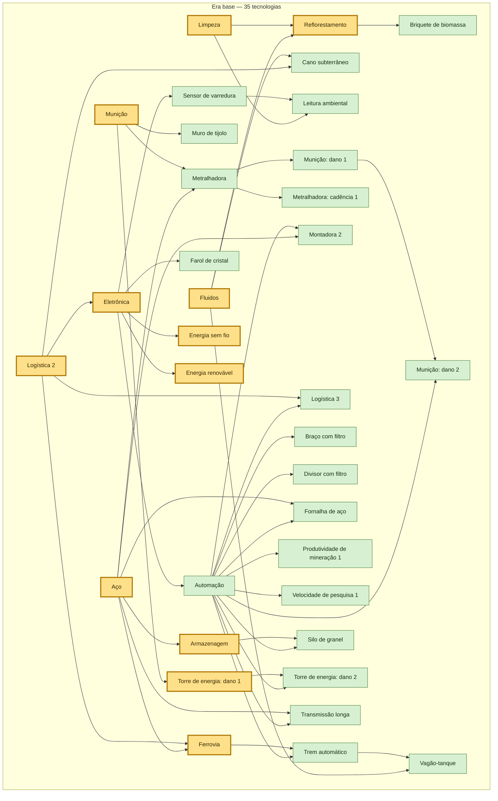
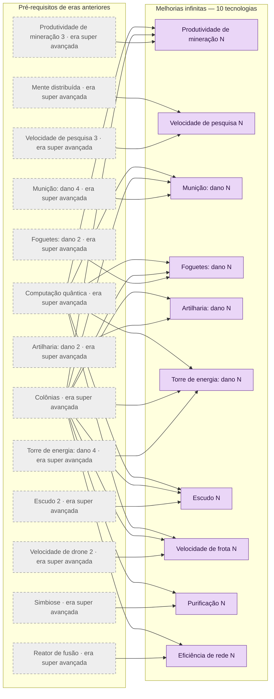

# Árvore de tecnologia — fluxograma

Gerado a partir da tabela principal de `ARVORE_TECNOLOGIA.md`. Leia da esquerda para a direita: cada seta vai de um pré-requisito para a tecnologia que ele libera, então as raízes (sem pré-requisito) ficam à esquerda e o foguete de proliferação e as melhorias infinitas à direita. Uma tecnologia só pode ser pesquisada quando todas as setas que chegam nela já foram pesquisadas. O diagrama geral tem as 166 tecnologias e fica grande demais para o celular; logo abaixo há um diagrama por era, em que os pré-requisitos que vêm de eras anteriores aparecem em cinza tracejado.

## Legenda

| Cor | Significado |
|---|---|
| Verde | Era base (35 tecnologias) |
| Azul | Era do meio (60 tecnologias) |
| Roxo | Era super avançada (71 tecnologias, das quais 10 são melhorias infinitas) |
| Amarelo com borda grossa | Uma das 96 pesquisas que já existem no jogo (`jogo/dados/progressao.json`); a cor substitui a da era: 28 na era base, 38 na era do meio, 30 na era super avançada |
| Laranja com borda vermelha | Objetivo final: foguete de proliferação |
| Cinza tracejado | (só nos diagramas por era) pré-requisito que vem de uma era anterior |

## Diagrama geral (166 tecnologias, 318 setas)

```mermaid
flowchart LR
  subgraph era_base["Era base — 35 tecnologias"]
    direction LR
    defesa["Munição"]
    logistica["Logística 2"]
    aco["Aço"]
    fluidos["Fluidos"]
    limpeza["Limpeza"]
    eletronica["Eletrônica"]
    armazenagem["Armazenagem"]
    reflorestar["Reflorestamento"]
    muros_reforcados["Muro de tijolo"]
    dano_energia_1["Torre de energia: dano 1"]
    cano_subterraneo["Cano subterrâneo"]
    sensor_varredura["Sensor de varredura"]
    farol_cristal["Farol de cristal"]
    monitor_ambiental["Leitura ambiental"]
    ferrovia["Ferrovia"]
    sem_fio["Energia sem fio"]
    renovavel["Energia renovável"]
    briquete["Briquete de biomassa"]
    automacao["Automação"]
    torre_metralhadora["Metralhadora"]
    dano_bala_1["Munição: dano 1"]
    cadencia_bala_1["Metralhadora: cadência 1"]
    montadora_2["Montadora 2"]
    logistica_3["Logística 3"]
    braco_filtro["Braço com filtro"]
    divisor_filtro["Divisor com filtro"]
    fornalha_aco["Fornalha de aço"]
    mineracao_1["Produtividade de mineração 1"]
    pesquisa_vel_1["Velocidade de pesquisa 1"]
    trem_automatico["Trem automático"]
    silo_granel["Silo de granel"]
    dano_bala_2["Munição: dano 2"]
    dano_energia_2["Torre de energia: dano 2"]
    transmissao["Transmissão longa"]
    vagao_tanque["Vagão-tanque"]
  end
  subgraph era_meio["Era do meio — 60 tecnologias"]
    direction LR
    refino["Refino de seiva"]
    acumulacao["Acumulação"]
    energia["Energia avançada"]
    bomba_agua["Água como insumo"]
    filtro_agua_limpa["Filtro que devolve água"]
    coletor_chuva["Coletor de chuva"]
    condensador_neblina["Condensador de neblina"]
    escavar_canal["Escavação de canal"]
    supressor_fogo["Supressor de incêndio"]
    turbina_rio["Turbina de correnteza"]
    para_raios["Para-raios"]
    ciencia_militar["Ciência militar"]
    drones["Drones de reparo"]
    drones_bateria_1["Bateria de drone 1"]
    quimica["Química de seiva"]
    liga_leve["Liga leve"]
    processador["Processador de cristal"]
    bioquimica["Bioquímica"]
    combustivel_seiva["Combustível de seiva"]
    fornalha_eletrica["Fornalha elétrica"]
    captador_carga["Captador de carga"]
    logistica_4["Logística 4"]
    braco_empilhador["Braço empilhador"]
    montadora_3["Montadora 3"]
    rede_logica["Rede lógica"]
    modulo_velocidade_1["Módulo de velocidade 1"]
    modulo_eficiencia_1["Módulo de eficiência 1"]
    modulo_produtividade_1["Módulo de produtividade 1"]
    broca_grande["Broca grande"]
    extrator_2["Extrator ressonante"]
    mineracao_2["Produtividade de mineração 2"]
    pesquisa_vel_2["Velocidade de pesquisa 2"]
    laboratorio_2["Laboratório 2"]
    drones_frota_1["Frota de drones 1"]
    drones_velocidade_1["Velocidade de drone 1"]
    drones_logisticos["Drones logísticos"]
    renovavel_2["Painel solar 2"]
    turbina_alta["Turbina eólica alta"]
    acumulacao_2["Acumulador 2"]
    trem_eletrico["Locomotiva elétrica"]
    cartografia["Varredura profunda"]
    coletor_lixo_2["Coletor de lixo 2"]
    purificador_ar["Purificador de ar"]
    viveiro_2["Viveiro 2"]
    biodigestor["Biodigestor"]
    recuperar_solo["Recuperação de solo"]
    harmonia_ninhos["Convivência com ninhos"]
    municao_perfurante["Munição perfurante"]
    dano_bala_3["Munição: dano 3"]
    cadencia_bala_2["Metralhadora: cadência 2"]
    dano_energia_3["Torre de energia: dano 3"]
    cadencia_energia_1["Torre de energia: cadência 1"]
    mina_pulso["Mina de pulso"]
    posto_avancado["Posto avançado"]
    torre_foguetes["Lança-foguetes"]
    dano_foguete_1["Foguetes: dano 1"]
    cadencia_foguete_1["Lança-foguetes: cadência 1"]
    muro_liga["Muro de liga"]
    escudo_1["Gerador de escudo"]
    artilharia["Artilharia"]
  end
  subgraph era_avancado["Era super avançada — 71 tecnologias"]
    direction LR
    ciencia_tempestade["Ciência de tempestade"]
    para_raios_2["Para-raios de cristal"]
    acumulador_cristal["Acumulador de cristal"]
    reator_cristal["Reator de cristal"]
    fundicao_cristal["Fundição de cristal"]
    refinador_2["Refinador 2"]
    irradiador_modulos["Irradiador de módulos"]
    modulo_velocidade_2["Módulo de velocidade 2"]
    modulo_eficiencia_2["Módulo de eficiência 2"]
    modulo_produtividade_2["Módulo de produtividade 2"]
    mineracao_3["Produtividade de mineração 3"]
    pesquisa_vel_3["Velocidade de pesquisa 3"]
    drones_frota_2["Frota de drones 2"]
    drones_bateria_2["Bateria de drone 2"]
    drones_velocidade_2["Velocidade de drone 2"]
    drones_logisticos_2["Drones logísticos 2"]
    drones_tempestade["Voo na tempestade"]
    drones_defesa["Drones de defesa"]
    purificador_ar_2["Purificador atmosférico"]
    estacao_tratamento["Estação de tratamento"]
    restauracao_bioma["Restauração de bioma"]
    semeadura_nuvens["Semeadura de nuvens"]
    cupula_tempestade["Cúpula contra raios"]
    controle_vento["Defletor de vento"]
    dano_bala_4["Munição: dano 4"]
    cadencia_bala_3["Metralhadora: cadência 3"]
    municao_cristal["Munição de cristal carregado"]
    dano_foguete_2["Foguetes: dano 2"]
    cadencia_foguete_2["Lança-foguetes: cadência 2"]
    foguete_enxame["Foguete de enxame"]
    dano_energia_4["Torre de energia: dano 4"]
    cadencia_energia_2["Torre de energia: cadência 2"]
    dano_artilharia_1["Artilharia: dano 1"]
    alcance_artilharia_1["Artilharia: alcance 1"]
    artilharia_automatica["Mira automática"]
    escudo_2["Escudo 2"]
    muro_escudo["Muro de campo"]
    nucleo_semente["Núcleo-semente"]
    colonias["Colônias"]
    computacao_quantica["Computação quântica"]
    modulo_velocidade_3["Módulo de velocidade 3"]
    modulo_eficiencia_3["Módulo de eficiência 3"]
    modulo_produtividade_3["Módulo de produtividade 3"]
    montadora_4["Montadora quântica"]
    logistica_5["Logística 5"]
    braco_quantico["Braço quântico"]
    broca_profunda["Broca de núcleo"]
    laboratorio_3["Laboratório quântico"]
    fusao["Reator de fusão"]
    controle_clima["Regulador climático"]
    simbiose["Simbiose"]
    dano_artilharia_2["Artilharia: dano 2"]
    alcance_artilharia_2["Artilharia: alcance 2"]
    transportador_quantico["Transportador quântico"]
    rede_colonias["Mente distribuída"]
    singularidade["Núcleo de singularidade"]
    casco_foguete["Casco de liga quântica"]
    propulsao_cristal["Propulsão de cristal"]
    navegacao["Navegação estelar"]
    silo_lancamento["Silo de lançamento"]
    foguete_proliferacao["Foguete de proliferação"]
    mineracao_infinita["Produtividade de mineração N"]
    pesquisa_infinita["Velocidade de pesquisa N"]
    dano_bala_infinito["Munição: dano N"]
    dano_foguete_infinito["Foguetes: dano N"]
    dano_artilharia_infinito["Artilharia: dano N"]
    dano_energia_infinito["Torre de energia: dano N"]
    escudo_infinito["Escudo N"]
    drones_infinito["Velocidade de frota N"]
    purificacao_infinita["Purificação N"]
    eficiencia_infinita["Eficiência de rede N"]
  end
  logistica --> eletronica
  aco --> armazenagem
  limpeza --> reflorestar
  fluidos --> reflorestar
  defesa --> muros_reforcados
  defesa --> dano_energia_1
  fluidos --> cano_subterraneo
  logistica --> cano_subterraneo
  eletronica --> sensor_varredura
  eletronica --> farol_cristal
  sensor_varredura --> monitor_ambiental
  limpeza --> monitor_ambiental
  logistica --> ferrovia
  aco --> ferrovia
  eletronica --> sem_fio
  eletronica --> renovavel
  reflorestar --> briquete
  eletronica --> automacao
  defesa --> torre_metralhadora
  aco --> torre_metralhadora
  torre_metralhadora --> dano_bala_1
  torre_metralhadora --> cadencia_bala_1
  automacao --> montadora_2
  aco --> montadora_2
  logistica --> logistica_3
  automacao --> logistica_3
  automacao --> braco_filtro
  automacao --> divisor_filtro
  aco --> fornalha_aco
  automacao --> fornalha_aco
  automacao --> mineracao_1
  automacao --> pesquisa_vel_1
  ferrovia --> trem_automatico
  automacao --> trem_automatico
  armazenagem --> silo_granel
  automacao --> silo_granel
  dano_bala_1 --> dano_bala_2
  automacao --> dano_bala_2
  dano_energia_1 --> dano_energia_2
  automacao --> dano_energia_2
  aco --> transmissao
  automacao --> transmissao
  trem_automatico --> vagao_tanque
  fluidos --> vagao_tanque
  fluidos --> refino
  eletronica --> refino
  aco --> refino
  renovavel --> acumulacao
  refino --> acumulacao
  refino --> energia
  fluidos --> bomba_agua
  automacao --> bomba_agua
  bomba_agua --> filtro_agua_limpa
  limpeza --> filtro_agua_limpa
  bomba_agua --> coletor_chuva
  coletor_chuva --> condensador_neblina
  bomba_agua --> escavar_canal
  bomba_agua --> supressor_fogo
  limpeza --> supressor_fogo
  bomba_agua --> turbina_rio
  renovavel --> turbina_rio
  automacao --> para_raios
  aco --> para_raios
  torre_metralhadora --> ciencia_militar
  muros_reforcados --> ciencia_militar
  automacao --> ciencia_militar
  bomba_agua --> drones
  sem_fio --> drones
  drones --> drones_bateria_1
  acumulacao --> drones_bateria_1
  refino --> quimica
  bomba_agua --> quimica
  quimica --> liga_leve
  aco --> liga_leve
  quimica --> processador
  reflorestar --> bioquimica
  filtro_agua_limpa --> bioquimica
  quimica --> bioquimica
  quimica --> combustivel_seiva
  briquete --> combustivel_seiva
  fornalha_aco --> fornalha_eletrica
  quimica --> fornalha_eletrica
  para_raios --> captador_carga
  acumulacao --> captador_carga
  quimica --> captador_carga
  logistica_3 --> logistica_4
  liga_leve --> logistica_4
  braco_filtro --> braco_empilhador
  processador --> braco_empilhador
  montadora_2 --> montadora_3
  processador --> montadora_3
  processador --> rede_logica
  divisor_filtro --> rede_logica
  processador --> modulo_velocidade_1
  montadora_2 --> modulo_velocidade_1
  processador --> modulo_eficiencia_1
  processador --> modulo_produtividade_1
  mineracao_1 --> broca_grande
  liga_leve --> broca_grande
  processador --> extrator_2
  mineracao_1 --> extrator_2
  mineracao_1 --> mineracao_2
  quimica --> mineracao_2
  pesquisa_vel_1 --> pesquisa_vel_2
  quimica --> pesquisa_vel_2
  pesquisa_vel_2 --> laboratorio_2
  processador --> laboratorio_2
  drones --> drones_frota_1
  processador --> drones_frota_1
  drones --> drones_velocidade_1
  liga_leve --> drones_velocidade_1
  drones --> drones_logisticos
  processador --> drones_logisticos
  silo_granel --> drones_logisticos
  renovavel --> renovavel_2
  processador --> renovavel_2
  renovavel --> turbina_alta
  liga_leve --> turbina_alta
  acumulacao --> acumulacao_2
  processador --> acumulacao_2
  trem_automatico --> trem_eletrico
  liga_leve --> trem_eletrico
  sensor_varredura --> cartografia
  processador --> cartografia
  limpeza --> coletor_lixo_2
  bioquimica --> coletor_lixo_2
  bioquimica --> purificador_ar
  reflorestar --> viveiro_2
  bioquimica --> viveiro_2
  bioquimica --> biodigestor
  coletor_lixo_2 --> biodigestor
  viveiro_2 --> recuperar_solo
  coletor_lixo_2 --> recuperar_solo
  monitor_ambiental --> harmonia_ninhos
  purificador_ar --> harmonia_ninhos
  ciencia_militar --> municao_perfurante
  dano_bala_2 --> municao_perfurante
  dano_bala_2 --> dano_bala_3
  ciencia_militar --> dano_bala_3
  cadencia_bala_1 --> cadencia_bala_2
  ciencia_militar --> cadencia_bala_2
  dano_energia_2 --> dano_energia_3
  ciencia_militar --> dano_energia_3
  dano_energia_2 --> cadencia_energia_1
  ciencia_militar --> cadencia_energia_1
  ciencia_militar --> mina_pulso
  transmissao --> posto_avancado
  silo_granel --> posto_avancado
  ciencia_militar --> posto_avancado
  ciencia_militar --> torre_foguetes
  quimica --> torre_foguetes
  torre_foguetes --> dano_foguete_1
  torre_foguetes --> cadencia_foguete_1
  muros_reforcados --> muro_liga
  liga_leve --> muro_liga
  ciencia_militar --> muro_liga
  ciencia_militar --> escudo_1
  processador --> escudo_1
  acumulacao --> escudo_1
  torre_foguetes --> artilharia
  liga_leve --> artilharia
  cartografia --> artilharia
  captador_carga --> ciencia_tempestade
  processador --> ciencia_tempestade
  liga_leve --> ciencia_tempestade
  bioquimica --> ciencia_tempestade
  para_raios --> para_raios_2
  ciencia_tempestade --> para_raios_2
  acumulacao_2 --> acumulador_cristal
  ciencia_tempestade --> acumulador_cristal
  energia --> reator_cristal
  ciencia_tempestade --> reator_cristal
  fornalha_eletrica --> fundicao_cristal
  ciencia_tempestade --> fundicao_cristal
  quimica --> refinador_2
  ciencia_tempestade --> refinador_2
  modulo_velocidade_1 --> irradiador_modulos
  modulo_eficiencia_1 --> irradiador_modulos
  ciencia_tempestade --> irradiador_modulos
  modulo_velocidade_1 --> modulo_velocidade_2
  ciencia_tempestade --> modulo_velocidade_2
  modulo_eficiencia_1 --> modulo_eficiencia_2
  ciencia_tempestade --> modulo_eficiencia_2
  modulo_produtividade_1 --> modulo_produtividade_2
  ciencia_tempestade --> modulo_produtividade_2
  mineracao_2 --> mineracao_3
  ciencia_tempestade --> mineracao_3
  pesquisa_vel_2 --> pesquisa_vel_3
  ciencia_tempestade --> pesquisa_vel_3
  drones_frota_1 --> drones_frota_2
  ciencia_tempestade --> drones_frota_2
  drones_bateria_1 --> drones_bateria_2
  ciencia_tempestade --> drones_bateria_2
  drones_velocidade_1 --> drones_velocidade_2
  ciencia_tempestade --> drones_velocidade_2
  drones_logisticos --> drones_logisticos_2
  ciencia_tempestade --> drones_logisticos_2
  drones_bateria_2 --> drones_tempestade
  para_raios_2 --> drones_tempestade
  drones_frota_1 --> drones_defesa
  dano_energia_3 --> drones_defesa
  ciencia_tempestade --> drones_defesa
  purificador_ar --> purificador_ar_2
  ciencia_tempestade --> purificador_ar_2
  filtro_agua_limpa --> estacao_tratamento
  refinador_2 --> estacao_tratamento
  recuperar_solo --> restauracao_bioma
  ciencia_tempestade --> restauracao_bioma
  condensador_neblina --> semeadura_nuvens
  ciencia_tempestade --> semeadura_nuvens
  para_raios_2 --> cupula_tempestade
  escudo_1 --> cupula_tempestade
  semeadura_nuvens --> controle_vento
  turbina_alta --> controle_vento
  dano_bala_3 --> dano_bala_4
  ciencia_tempestade --> dano_bala_4
  cadencia_bala_2 --> cadencia_bala_3
  ciencia_tempestade --> cadencia_bala_3
  municao_perfurante --> municao_cristal
  ciencia_tempestade --> municao_cristal
  dano_foguete_1 --> dano_foguete_2
  ciencia_tempestade --> dano_foguete_2
  cadencia_foguete_1 --> cadencia_foguete_2
  ciencia_tempestade --> cadencia_foguete_2
  dano_foguete_2 --> foguete_enxame
  dano_energia_3 --> dano_energia_4
  ciencia_tempestade --> dano_energia_4
  cadencia_energia_1 --> cadencia_energia_2
  ciencia_tempestade --> cadencia_energia_2
  artilharia --> dano_artilharia_1
  ciencia_tempestade --> dano_artilharia_1
  artilharia --> alcance_artilharia_1
  ciencia_tempestade --> alcance_artilharia_1
  alcance_artilharia_1 --> artilharia_automatica
  cartografia --> artilharia_automatica
  escudo_1 --> escudo_2
  ciencia_tempestade --> escudo_2
  muro_liga --> muro_escudo
  escudo_2 --> muro_escudo
  posto_avancado --> nucleo_semente
  drones_frota_1 --> nucleo_semente
  ciencia_tempestade --> nucleo_semente
  nucleo_semente --> colonias
  drones_logisticos --> colonias
  ciencia_tempestade --> computacao_quantica
  laboratorio_2 --> computacao_quantica
  energia --> computacao_quantica
  modulo_velocidade_2 --> modulo_velocidade_3
  computacao_quantica --> modulo_velocidade_3
  modulo_eficiencia_2 --> modulo_eficiencia_3
  computacao_quantica --> modulo_eficiencia_3
  modulo_produtividade_2 --> modulo_produtividade_3
  computacao_quantica --> modulo_produtividade_3
  montadora_3 --> montadora_4
  computacao_quantica --> montadora_4
  logistica_4 --> logistica_5
  computacao_quantica --> logistica_5
  braco_empilhador --> braco_quantico
  computacao_quantica --> braco_quantico
  broca_grande --> broca_profunda
  computacao_quantica --> broca_profunda
  laboratorio_2 --> laboratorio_3
  computacao_quantica --> laboratorio_3
  reator_cristal --> fusao
  computacao_quantica --> fusao
  controle_vento --> controle_clima
  cupula_tempestade --> controle_clima
  computacao_quantica --> controle_clima
  restauracao_bioma --> simbiose
  harmonia_ninhos --> simbiose
  computacao_quantica --> simbiose
  dano_artilharia_1 --> dano_artilharia_2
  computacao_quantica --> dano_artilharia_2
  alcance_artilharia_1 --> alcance_artilharia_2
  computacao_quantica --> alcance_artilharia_2
  colonias --> transportador_quantico
  computacao_quantica --> transportador_quantico
  transportador_quantico --> rede_colonias
  fusao --> singularidade
  colonias --> singularidade
  liga_leve --> casco_foguete
  computacao_quantica --> casco_foguete
  reator_cristal --> propulsao_cristal
  computacao_quantica --> propulsao_cristal
  cartografia --> navegacao
  computacao_quantica --> navegacao
  colonias --> navegacao
  casco_foguete --> silo_lancamento
  propulsao_cristal --> silo_lancamento
  silo_lancamento --> foguete_proliferacao
  navegacao --> foguete_proliferacao
  rede_colonias --> foguete_proliferacao
  mineracao_3 --> mineracao_infinita
  colonias --> mineracao_infinita
  computacao_quantica --> mineracao_infinita
  pesquisa_vel_3 --> pesquisa_infinita
  rede_colonias --> pesquisa_infinita
  dano_bala_4 --> dano_bala_infinito
  colonias --> dano_bala_infinito
  computacao_quantica --> dano_bala_infinito
  dano_foguete_2 --> dano_foguete_infinito
  colonias --> dano_foguete_infinito
  computacao_quantica --> dano_foguete_infinito
  dano_artilharia_2 --> dano_artilharia_infinito
  colonias --> dano_artilharia_infinito
  dano_energia_4 --> dano_energia_infinito
  colonias --> dano_energia_infinito
  computacao_quantica --> dano_energia_infinito
  escudo_2 --> escudo_infinito
  colonias --> escudo_infinito
  computacao_quantica --> escudo_infinito
  drones_velocidade_2 --> drones_infinito
  colonias --> drones_infinito
  computacao_quantica --> drones_infinito
  simbiose --> purificacao_infinita
  colonias --> purificacao_infinita
  fusao --> eficiencia_infinita
  colonias --> eficiencia_infinita
  classDef base fill:#d8f0d2,stroke:#3c7a32,color:#14300f
  classDef meio fill:#d4e4fa,stroke:#2f5f9e,color:#0e2340
  classDef avancado fill:#ead6f7,stroke:#6f3a99,color:#2a0f40
  classDef existente fill:#ffe08a,stroke:#b07800,stroke-width:3px,color:#3a2700
  classDef objetivo fill:#ff9f80,stroke:#b3261e,stroke-width:4px,color:#3d0a05
  class muros_reforcados,cano_subterraneo,sensor_varredura,farol_cristal,monitor_ambiental,briquete,automacao,torre_metralhadora,dano_bala_1,cadencia_bala_1,montadora_2,logistica_3,braco_filtro,divisor_filtro,fornalha_aco,mineracao_1,pesquisa_vel_1,trem_automatico,silo_granel,dano_bala_2,dano_energia_2,transmissao,vagao_tanque base
  class bomba_agua,filtro_agua_limpa,coletor_chuva,condensador_neblina,escavar_canal,supressor_fogo,turbina_rio,para_raios,ciencia_militar,drones,drones_bateria_1,quimica,liga_leve,processador,bioquimica,combustivel_seiva,fornalha_eletrica,captador_carga,logistica_4,braco_empilhador,montadora_3,rede_logica,modulo_velocidade_1,modulo_eficiencia_1,modulo_produtividade_1,broca_grande,extrator_2,mineracao_2,pesquisa_vel_2,laboratorio_2,drones_frota_1,drones_velocidade_1,drones_logisticos,renovavel_2,turbina_alta,acumulacao_2,trem_eletrico,cartografia,coletor_lixo_2,purificador_ar,viveiro_2,biodigestor,recuperar_solo,harmonia_ninhos,municao_perfurante,dano_bala_3,cadencia_bala_2,dano_energia_3,cadencia_energia_1,mina_pulso,posto_avancado,torre_foguetes,dano_foguete_1,cadencia_foguete_1,muro_liga,escudo_1,artilharia meio
  class ciencia_tempestade,para_raios_2,acumulador_cristal,reator_cristal,fundicao_cristal,refinador_2,irradiador_modulos,modulo_velocidade_2,modulo_eficiencia_2,modulo_produtividade_2,mineracao_3,pesquisa_vel_3,drones_frota_2,drones_bateria_2,drones_velocidade_2,drones_logisticos_2,drones_tempestade,drones_defesa,purificador_ar_2,estacao_tratamento,restauracao_bioma,semeadura_nuvens,cupula_tempestade,controle_vento,dano_bala_4,cadencia_bala_3,municao_cristal,dano_foguete_2,cadencia_foguete_2,foguete_enxame,dano_energia_4,cadencia_energia_2,dano_artilharia_1,alcance_artilharia_1,artilharia_automatica,escudo_2,muro_escudo,nucleo_semente,colonias,computacao_quantica,modulo_velocidade_3,modulo_eficiencia_3,modulo_produtividade_3,montadora_4,logistica_5,braco_quantico,broca_profunda,laboratorio_3,fusao,controle_clima,simbiose,dano_artilharia_2,alcance_artilharia_2,transportador_quantico,rede_colonias,singularidade,casco_foguete,propulsao_cristal,navegacao,silo_lancamento,mineracao_infinita,pesquisa_infinita,dano_bala_infinito,dano_foguete_infinito,dano_artilharia_infinito,dano_energia_infinito,escudo_infinito,drones_infinito,purificacao_infinita,eficiencia_infinita avancado
  class defesa,dano_energia_1,logistica,aco,fluidos,limpeza,eletronica,armazenagem,reflorestar,ferrovia,sem_fio,renovavel,refino,acumulacao,energia existente
  class foguete_proliferacao objetivo
```

## Era base (35 tecnologias, 44 setas, 0 pré-requisitos de fora)



## Era do meio (60 tecnologias, 118 setas, 26 pré-requisitos de fora)

```mermaid
flowchart LR
  subgraph vindos["Pré-requisitos de eras anteriores"]
    direction LR
    fluidos["Fluidos · era base"]
    eletronica["Eletrônica · era base"]
    aco["Aço · era base"]
    renovavel["Energia renovável · era base"]
    automacao["Automação · era base"]
    limpeza["Limpeza · era base"]
    torre_metralhadora["Metralhadora · era base"]
    muros_reforcados["Muro de tijolo · era base"]
    sem_fio["Energia sem fio · era base"]
    reflorestar["Reflorestamento · era base"]
    briquete["Briquete de biomassa · era base"]
    fornalha_aco["Fornalha de aço · era base"]
    logistica_3["Logística 3 · era base"]
    braco_filtro["Braço com filtro · era base"]
    montadora_2["Montadora 2 · era base"]
    divisor_filtro["Divisor com filtro · era base"]
    mineracao_1["Produtividade de mineração 1 · era base"]
    pesquisa_vel_1["Velocidade de pesquisa 1 · era base"]
    silo_granel["Silo de granel · era base"]
    trem_automatico["Trem automático · era base"]
    sensor_varredura["Sensor de varredura · era base"]
    monitor_ambiental["Leitura ambiental · era base"]
    dano_bala_2["Munição: dano 2 · era base"]
    cadencia_bala_1["Metralhadora: cadência 1 · era base"]
    dano_energia_2["Torre de energia: dano 2 · era base"]
    transmissao["Transmissão longa · era base"]
  end
  subgraph bloco_meio["Era do meio — 60 tecnologias"]
    direction LR
    refino["Refino de seiva"]
    acumulacao["Acumulação"]
    energia["Energia avançada"]
    bomba_agua["Água como insumo"]
    filtro_agua_limpa["Filtro que devolve água"]
    coletor_chuva["Coletor de chuva"]
    condensador_neblina["Condensador de neblina"]
    escavar_canal["Escavação de canal"]
    supressor_fogo["Supressor de incêndio"]
    turbina_rio["Turbina de correnteza"]
    para_raios["Para-raios"]
    ciencia_militar["Ciência militar"]
    drones["Drones de reparo"]
    drones_bateria_1["Bateria de drone 1"]
    quimica["Química de seiva"]
    liga_leve["Liga leve"]
    processador["Processador de cristal"]
    bioquimica["Bioquímica"]
    combustivel_seiva["Combustível de seiva"]
    fornalha_eletrica["Fornalha elétrica"]
    captador_carga["Captador de carga"]
    logistica_4["Logística 4"]
    braco_empilhador["Braço empilhador"]
    montadora_3["Montadora 3"]
    rede_logica["Rede lógica"]
    modulo_velocidade_1["Módulo de velocidade 1"]
    modulo_eficiencia_1["Módulo de eficiência 1"]
    modulo_produtividade_1["Módulo de produtividade 1"]
    broca_grande["Broca grande"]
    extrator_2["Extrator ressonante"]
    mineracao_2["Produtividade de mineração 2"]
    pesquisa_vel_2["Velocidade de pesquisa 2"]
    laboratorio_2["Laboratório 2"]
    drones_frota_1["Frota de drones 1"]
    drones_velocidade_1["Velocidade de drone 1"]
    drones_logisticos["Drones logísticos"]
    renovavel_2["Painel solar 2"]
    turbina_alta["Turbina eólica alta"]
    acumulacao_2["Acumulador 2"]
    trem_eletrico["Locomotiva elétrica"]
    cartografia["Varredura profunda"]
    coletor_lixo_2["Coletor de lixo 2"]
    purificador_ar["Purificador de ar"]
    viveiro_2["Viveiro 2"]
    biodigestor["Biodigestor"]
    recuperar_solo["Recuperação de solo"]
    harmonia_ninhos["Convivência com ninhos"]
    municao_perfurante["Munição perfurante"]
    dano_bala_3["Munição: dano 3"]
    cadencia_bala_2["Metralhadora: cadência 2"]
    dano_energia_3["Torre de energia: dano 3"]
    cadencia_energia_1["Torre de energia: cadência 1"]
    mina_pulso["Mina de pulso"]
    posto_avancado["Posto avançado"]
    torre_foguetes["Lança-foguetes"]
    dano_foguete_1["Foguetes: dano 1"]
    cadencia_foguete_1["Lança-foguetes: cadência 1"]
    muro_liga["Muro de liga"]
    escudo_1["Gerador de escudo"]
    artilharia["Artilharia"]
  end
  fluidos --> refino
  eletronica --> refino
  aco --> refino
  renovavel --> acumulacao
  refino --> acumulacao
  refino --> energia
  fluidos --> bomba_agua
  automacao --> bomba_agua
  bomba_agua --> filtro_agua_limpa
  limpeza --> filtro_agua_limpa
  bomba_agua --> coletor_chuva
  coletor_chuva --> condensador_neblina
  bomba_agua --> escavar_canal
  bomba_agua --> supressor_fogo
  limpeza --> supressor_fogo
  bomba_agua --> turbina_rio
  renovavel --> turbina_rio
  automacao --> para_raios
  aco --> para_raios
  torre_metralhadora --> ciencia_militar
  muros_reforcados --> ciencia_militar
  automacao --> ciencia_militar
  bomba_agua --> drones
  sem_fio --> drones
  drones --> drones_bateria_1
  acumulacao --> drones_bateria_1
  refino --> quimica
  bomba_agua --> quimica
  quimica --> liga_leve
  aco --> liga_leve
  quimica --> processador
  reflorestar --> bioquimica
  filtro_agua_limpa --> bioquimica
  quimica --> bioquimica
  quimica --> combustivel_seiva
  briquete --> combustivel_seiva
  fornalha_aco --> fornalha_eletrica
  quimica --> fornalha_eletrica
  para_raios --> captador_carga
  acumulacao --> captador_carga
  quimica --> captador_carga
  logistica_3 --> logistica_4
  liga_leve --> logistica_4
  braco_filtro --> braco_empilhador
  processador --> braco_empilhador
  montadora_2 --> montadora_3
  processador --> montadora_3
  processador --> rede_logica
  divisor_filtro --> rede_logica
  processador --> modulo_velocidade_1
  montadora_2 --> modulo_velocidade_1
  processador --> modulo_eficiencia_1
  processador --> modulo_produtividade_1
  mineracao_1 --> broca_grande
  liga_leve --> broca_grande
  processador --> extrator_2
  mineracao_1 --> extrator_2
  mineracao_1 --> mineracao_2
  quimica --> mineracao_2
  pesquisa_vel_1 --> pesquisa_vel_2
  quimica --> pesquisa_vel_2
  pesquisa_vel_2 --> laboratorio_2
  processador --> laboratorio_2
  drones --> drones_frota_1
  processador --> drones_frota_1
  drones --> drones_velocidade_1
  liga_leve --> drones_velocidade_1
  drones --> drones_logisticos
  processador --> drones_logisticos
  silo_granel --> drones_logisticos
  renovavel --> renovavel_2
  processador --> renovavel_2
  renovavel --> turbina_alta
  liga_leve --> turbina_alta
  acumulacao --> acumulacao_2
  processador --> acumulacao_2
  trem_automatico --> trem_eletrico
  liga_leve --> trem_eletrico
  sensor_varredura --> cartografia
  processador --> cartografia
  limpeza --> coletor_lixo_2
  bioquimica --> coletor_lixo_2
  bioquimica --> purificador_ar
  reflorestar --> viveiro_2
  bioquimica --> viveiro_2
  bioquimica --> biodigestor
  coletor_lixo_2 --> biodigestor
  viveiro_2 --> recuperar_solo
  coletor_lixo_2 --> recuperar_solo
  monitor_ambiental --> harmonia_ninhos
  purificador_ar --> harmonia_ninhos
  ciencia_militar --> municao_perfurante
  dano_bala_2 --> municao_perfurante
  dano_bala_2 --> dano_bala_3
  ciencia_militar --> dano_bala_3
  cadencia_bala_1 --> cadencia_bala_2
  ciencia_militar --> cadencia_bala_2
  dano_energia_2 --> dano_energia_3
  ciencia_militar --> dano_energia_3
  dano_energia_2 --> cadencia_energia_1
  ciencia_militar --> cadencia_energia_1
  ciencia_militar --> mina_pulso
  transmissao --> posto_avancado
  silo_granel --> posto_avancado
  ciencia_militar --> posto_avancado
  ciencia_militar --> torre_foguetes
  quimica --> torre_foguetes
  torre_foguetes --> dano_foguete_1
  torre_foguetes --> cadencia_foguete_1
  muros_reforcados --> muro_liga
  liga_leve --> muro_liga
  ciencia_militar --> muro_liga
  ciencia_militar --> escudo_1
  processador --> escudo_1
  acumulacao --> escudo_1
  torre_foguetes --> artilharia
  liga_leve --> artilharia
  cartografia --> artilharia
  classDef base fill:#d8f0d2,stroke:#3c7a32,color:#14300f
  classDef meio fill:#d4e4fa,stroke:#2f5f9e,color:#0e2340
  classDef avancado fill:#ead6f7,stroke:#6f3a99,color:#2a0f40
  classDef existente fill:#ffe08a,stroke:#b07800,stroke-width:3px,color:#3a2700
  classDef objetivo fill:#ff9f80,stroke:#b3261e,stroke-width:4px,color:#3d0a05
  classDef externo fill:#eeeeee,stroke:#888888,stroke-dasharray:5 4,color:#555555
  class refino,acumulacao,energia existente
  class bomba_agua,filtro_agua_limpa,coletor_chuva,condensador_neblina,escavar_canal,supressor_fogo,turbina_rio,para_raios,ciencia_militar,drones,drones_bateria_1,quimica,liga_leve,processador,bioquimica,combustivel_seiva,fornalha_eletrica,captador_carga,logistica_4,braco_empilhador,montadora_3,rede_logica,modulo_velocidade_1,modulo_eficiencia_1,modulo_produtividade_1,broca_grande,extrator_2,mineracao_2,pesquisa_vel_2,laboratorio_2,drones_frota_1,drones_velocidade_1,drones_logisticos,renovavel_2,turbina_alta,acumulacao_2,trem_eletrico,cartografia,coletor_lixo_2,purificador_ar,viveiro_2,biodigestor,recuperar_solo,harmonia_ninhos,municao_perfurante,dano_bala_3,cadencia_bala_2,dano_energia_3,cadencia_energia_1,mina_pulso,posto_avancado,torre_foguetes,dano_foguete_1,cadencia_foguete_1,muro_liga,escudo_1,artilharia meio
  class fluidos,eletronica,aco,renovavel,automacao,limpeza,torre_metralhadora,muros_reforcados,sem_fio,reflorestar,briquete,fornalha_aco,logistica_3,braco_filtro,montadora_2,divisor_filtro,mineracao_1,pesquisa_vel_1,silo_granel,trem_automatico,sensor_varredura,monitor_ambiental,dano_bala_2,cadencia_bala_1,dano_energia_2,transmissao externo
```



## Era super avançada (61 tecnologias, 130 setas, 41 pré-requisitos de fora)

```mermaid
flowchart LR
  subgraph vindos["Pré-requisitos de eras anteriores"]
    direction LR
    captador_carga["Captador de carga · era do meio"]
    processador["Processador de cristal · era do meio"]
    liga_leve["Liga leve · era do meio"]
    bioquimica["Bioquímica · era do meio"]
    para_raios["Para-raios · era do meio"]
    acumulacao_2["Acumulador 2 · era do meio"]
    energia["Energia avançada · era do meio"]
    fornalha_eletrica["Fornalha elétrica · era do meio"]
    quimica["Química de seiva · era do meio"]
    modulo_velocidade_1["Módulo de velocidade 1 · era do meio"]
    modulo_eficiencia_1["Módulo de eficiência 1 · era do meio"]
    modulo_produtividade_1["Módulo de produtividade 1 · era do meio"]
    mineracao_2["Produtividade de mineração 2 · era do meio"]
    pesquisa_vel_2["Velocidade de pesquisa 2 · era do meio"]
    drones_frota_1["Frota de drones 1 · era do meio"]
    drones_bateria_1["Bateria de drone 1 · era do meio"]
    drones_velocidade_1["Velocidade de drone 1 · era do meio"]
    drones_logisticos["Drones logísticos · era do meio"]
    dano_energia_3["Torre de energia: dano 3 · era do meio"]
    purificador_ar["Purificador de ar · era do meio"]
    filtro_agua_limpa["Filtro que devolve água · era do meio"]
    recuperar_solo["Recuperação de solo · era do meio"]
    condensador_neblina["Condensador de neblina · era do meio"]
    escudo_1["Gerador de escudo · era do meio"]
    turbina_alta["Turbina eólica alta · era do meio"]
    dano_bala_3["Munição: dano 3 · era do meio"]
    cadencia_bala_2["Metralhadora: cadência 2 · era do meio"]
    municao_perfurante["Munição perfurante · era do meio"]
    dano_foguete_1["Foguetes: dano 1 · era do meio"]
    cadencia_foguete_1["Lança-foguetes: cadência 1 · era do meio"]
    cadencia_energia_1["Torre de energia: cadência 1 · era do meio"]
    artilharia["Artilharia · era do meio"]
    cartografia["Varredura profunda · era do meio"]
    muro_liga["Muro de liga · era do meio"]
    posto_avancado["Posto avançado · era do meio"]
    laboratorio_2["Laboratório 2 · era do meio"]
    montadora_3["Montadora 3 · era do meio"]
    logistica_4["Logística 4 · era do meio"]
    braco_empilhador["Braço empilhador · era do meio"]
    broca_grande["Broca grande · era do meio"]
    harmonia_ninhos["Convivência com ninhos · era do meio"]
  end
  subgraph bloco_avancado["Era super avançada — 61 tecnologias"]
    direction LR
    ciencia_tempestade["Ciência de tempestade"]
    para_raios_2["Para-raios de cristal"]
    acumulador_cristal["Acumulador de cristal"]
    reator_cristal["Reator de cristal"]
    fundicao_cristal["Fundição de cristal"]
    refinador_2["Refinador 2"]
    irradiador_modulos["Irradiador de módulos"]
    modulo_velocidade_2["Módulo de velocidade 2"]
    modulo_eficiencia_2["Módulo de eficiência 2"]
    modulo_produtividade_2["Módulo de produtividade 2"]
    mineracao_3["Produtividade de mineração 3"]
    pesquisa_vel_3["Velocidade de pesquisa 3"]
    drones_frota_2["Frota de drones 2"]
    drones_bateria_2["Bateria de drone 2"]
    drones_velocidade_2["Velocidade de drone 2"]
    drones_logisticos_2["Drones logísticos 2"]
    drones_tempestade["Voo na tempestade"]
    drones_defesa["Drones de defesa"]
    purificador_ar_2["Purificador atmosférico"]
    estacao_tratamento["Estação de tratamento"]
    restauracao_bioma["Restauração de bioma"]
    semeadura_nuvens["Semeadura de nuvens"]
    cupula_tempestade["Cúpula contra raios"]
    controle_vento["Defletor de vento"]
    dano_bala_4["Munição: dano 4"]
    cadencia_bala_3["Metralhadora: cadência 3"]
    municao_cristal["Munição de cristal carregado"]
    dano_foguete_2["Foguetes: dano 2"]
    cadencia_foguete_2["Lança-foguetes: cadência 2"]
    foguete_enxame["Foguete de enxame"]
    dano_energia_4["Torre de energia: dano 4"]
    cadencia_energia_2["Torre de energia: cadência 2"]
    dano_artilharia_1["Artilharia: dano 1"]
    alcance_artilharia_1["Artilharia: alcance 1"]
    artilharia_automatica["Mira automática"]
    escudo_2["Escudo 2"]
    muro_escudo["Muro de campo"]
    nucleo_semente["Núcleo-semente"]
    colonias["Colônias"]
    computacao_quantica["Computação quântica"]
    modulo_velocidade_3["Módulo de velocidade 3"]
    modulo_eficiencia_3["Módulo de eficiência 3"]
    modulo_produtividade_3["Módulo de produtividade 3"]
    montadora_4["Montadora quântica"]
    logistica_5["Logística 5"]
    braco_quantico["Braço quântico"]
    broca_profunda["Broca de núcleo"]
    laboratorio_3["Laboratório quântico"]
    fusao["Reator de fusão"]
    controle_clima["Regulador climático"]
    simbiose["Simbiose"]
    dano_artilharia_2["Artilharia: dano 2"]
    alcance_artilharia_2["Artilharia: alcance 2"]
    transportador_quantico["Transportador quântico"]
    rede_colonias["Mente distribuída"]
    singularidade["Núcleo de singularidade"]
    casco_foguete["Casco de liga quântica"]
    propulsao_cristal["Propulsão de cristal"]
    navegacao["Navegação estelar"]
    silo_lancamento["Silo de lançamento"]
    foguete_proliferacao["Foguete de proliferação"]
  end
  captador_carga --> ciencia_tempestade
  processador --> ciencia_tempestade
  liga_leve --> ciencia_tempestade
  bioquimica --> ciencia_tempestade
  para_raios --> para_raios_2
  ciencia_tempestade --> para_raios_2
  acumulacao_2 --> acumulador_cristal
  ciencia_tempestade --> acumulador_cristal
  energia --> reator_cristal
  ciencia_tempestade --> reator_cristal
  fornalha_eletrica --> fundicao_cristal
  ciencia_tempestade --> fundicao_cristal
  quimica --> refinador_2
  ciencia_tempestade --> refinador_2
  modulo_velocidade_1 --> irradiador_modulos
  modulo_eficiencia_1 --> irradiador_modulos
  ciencia_tempestade --> irradiador_modulos
  modulo_velocidade_1 --> modulo_velocidade_2
  ciencia_tempestade --> modulo_velocidade_2
  modulo_eficiencia_1 --> modulo_eficiencia_2
  ciencia_tempestade --> modulo_eficiencia_2
  modulo_produtividade_1 --> modulo_produtividade_2
  ciencia_tempestade --> modulo_produtividade_2
  mineracao_2 --> mineracao_3
  ciencia_tempestade --> mineracao_3
  pesquisa_vel_2 --> pesquisa_vel_3
  ciencia_tempestade --> pesquisa_vel_3
  drones_frota_1 --> drones_frota_2
  ciencia_tempestade --> drones_frota_2
  drones_bateria_1 --> drones_bateria_2
  ciencia_tempestade --> drones_bateria_2
  drones_velocidade_1 --> drones_velocidade_2
  ciencia_tempestade --> drones_velocidade_2
  drones_logisticos --> drones_logisticos_2
  ciencia_tempestade --> drones_logisticos_2
  drones_bateria_2 --> drones_tempestade
  para_raios_2 --> drones_tempestade
  drones_frota_1 --> drones_defesa
  dano_energia_3 --> drones_defesa
  ciencia_tempestade --> drones_defesa
  purificador_ar --> purificador_ar_2
  ciencia_tempestade --> purificador_ar_2
  filtro_agua_limpa --> estacao_tratamento
  refinador_2 --> estacao_tratamento
  recuperar_solo --> restauracao_bioma
  ciencia_tempestade --> restauracao_bioma
  condensador_neblina --> semeadura_nuvens
  ciencia_tempestade --> semeadura_nuvens
  para_raios_2 --> cupula_tempestade
  escudo_1 --> cupula_tempestade
  semeadura_nuvens --> controle_vento
  turbina_alta --> controle_vento
  dano_bala_3 --> dano_bala_4
  ciencia_tempestade --> dano_bala_4
  cadencia_bala_2 --> cadencia_bala_3
  ciencia_tempestade --> cadencia_bala_3
  municao_perfurante --> municao_cristal
  ciencia_tempestade --> municao_cristal
  dano_foguete_1 --> dano_foguete_2
  ciencia_tempestade --> dano_foguete_2
  cadencia_foguete_1 --> cadencia_foguete_2
  ciencia_tempestade --> cadencia_foguete_2
  dano_foguete_2 --> foguete_enxame
  dano_energia_3 --> dano_energia_4
  ciencia_tempestade --> dano_energia_4
  cadencia_energia_1 --> cadencia_energia_2
  ciencia_tempestade --> cadencia_energia_2
  artilharia --> dano_artilharia_1
  ciencia_tempestade --> dano_artilharia_1
  artilharia --> alcance_artilharia_1
  ciencia_tempestade --> alcance_artilharia_1
  alcance_artilharia_1 --> artilharia_automatica
  cartografia --> artilharia_automatica
  escudo_1 --> escudo_2
  ciencia_tempestade --> escudo_2
  muro_liga --> muro_escudo
  escudo_2 --> muro_escudo
  posto_avancado --> nucleo_semente
  drones_frota_1 --> nucleo_semente
  ciencia_tempestade --> nucleo_semente
  nucleo_semente --> colonias
  drones_logisticos --> colonias
  ciencia_tempestade --> computacao_quantica
  laboratorio_2 --> computacao_quantica
  energia --> computacao_quantica
  modulo_velocidade_2 --> modulo_velocidade_3
  computacao_quantica --> modulo_velocidade_3
  modulo_eficiencia_2 --> modulo_eficiencia_3
  computacao_quantica --> modulo_eficiencia_3
  modulo_produtividade_2 --> modulo_produtividade_3
  computacao_quantica --> modulo_produtividade_3
  montadora_3 --> montadora_4
  computacao_quantica --> montadora_4
  logistica_4 --> logistica_5
  computacao_quantica --> logistica_5
  braco_empilhador --> braco_quantico
  computacao_quantica --> braco_quantico
  broca_grande --> broca_profunda
  computacao_quantica --> broca_profunda
  laboratorio_2 --> laboratorio_3
  computacao_quantica --> laboratorio_3
  reator_cristal --> fusao
  computacao_quantica --> fusao
  controle_vento --> controle_clima
  cupula_tempestade --> controle_clima
  computacao_quantica --> controle_clima
  restauracao_bioma --> simbiose
  harmonia_ninhos --> simbiose
  computacao_quantica --> simbiose
  dano_artilharia_1 --> dano_artilharia_2
  computacao_quantica --> dano_artilharia_2
  alcance_artilharia_1 --> alcance_artilharia_2
  computacao_quantica --> alcance_artilharia_2
  colonias --> transportador_quantico
  computacao_quantica --> transportador_quantico
  transportador_quantico --> rede_colonias
  fusao --> singularidade
  colonias --> singularidade
  liga_leve --> casco_foguete
  computacao_quantica --> casco_foguete
  reator_cristal --> propulsao_cristal
  computacao_quantica --> propulsao_cristal
  cartografia --> navegacao
  computacao_quantica --> navegacao
  colonias --> navegacao
  casco_foguete --> silo_lancamento
  propulsao_cristal --> silo_lancamento
  silo_lancamento --> foguete_proliferacao
  navegacao --> foguete_proliferacao
  rede_colonias --> foguete_proliferacao
  classDef base fill:#d8f0d2,stroke:#3c7a32,color:#14300f
  classDef meio fill:#d4e4fa,stroke:#2f5f9e,color:#0e2340
  classDef avancado fill:#ead6f7,stroke:#6f3a99,color:#2a0f40
  classDef existente fill:#ffe08a,stroke:#b07800,stroke-width:3px,color:#3a2700
  classDef objetivo fill:#ff9f80,stroke:#b3261e,stroke-width:4px,color:#3d0a05
  classDef externo fill:#eeeeee,stroke:#888888,stroke-dasharray:5 4,color:#555555
  class ciencia_tempestade,para_raios_2,acumulador_cristal,reator_cristal,fundicao_cristal,refinador_2,irradiador_modulos,modulo_velocidade_2,modulo_eficiencia_2,modulo_produtividade_2,mineracao_3,pesquisa_vel_3,drones_frota_2,drones_bateria_2,drones_velocidade_2,drones_logisticos_2,drones_tempestade,drones_defesa,purificador_ar_2,estacao_tratamento,restauracao_bioma,semeadura_nuvens,cupula_tempestade,controle_vento,dano_bala_4,cadencia_bala_3,municao_cristal,dano_foguete_2,cadencia_foguete_2,foguete_enxame,dano_energia_4,cadencia_energia_2,dano_artilharia_1,alcance_artilharia_1,artilharia_automatica,escudo_2,muro_escudo,nucleo_semente,colonias,computacao_quantica,modulo_velocidade_3,modulo_eficiencia_3,modulo_produtividade_3,montadora_4,logistica_5,braco_quantico,broca_profunda,laboratorio_3,fusao,controle_clima,simbiose,dano_artilharia_2,alcance_artilharia_2,transportador_quantico,rede_colonias,singularidade,casco_foguete,propulsao_cristal,navegacao,silo_lancamento avancado
  class foguete_proliferacao objetivo
  class captador_carga,processador,liga_leve,bioquimica,para_raios,acumulacao_2,energia,fornalha_eletrica,quimica,modulo_velocidade_1,modulo_eficiencia_1,modulo_produtividade_1,mineracao_2,pesquisa_vel_2,drones_frota_1,drones_bateria_1,drones_velocidade_1,drones_logisticos,dano_energia_3,purificador_ar,filtro_agua_limpa,recuperar_solo,condensador_neblina,escudo_1,turbina_alta,dano_bala_3,cadencia_bala_2,municao_perfurante,dano_foguete_1,cadencia_foguete_1,cadencia_energia_1,artilharia,cartografia,muro_liga,posto_avancado,laboratorio_2,montadora_3,logistica_4,braco_empilhador,broca_grande,harmonia_ninhos externo
```



## Melhorias infinitas (10 tecnologias, 26 setas, 13 pré-requisitos de fora)


